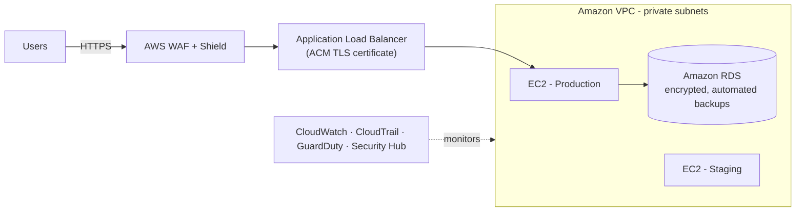
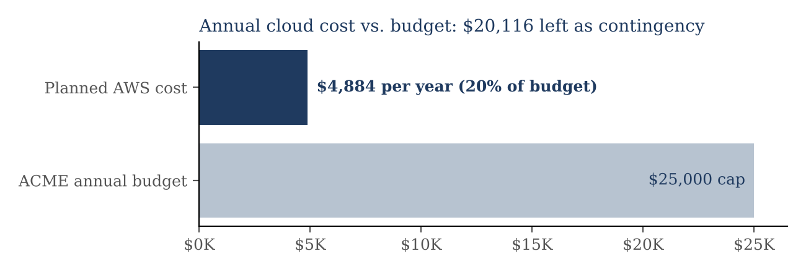
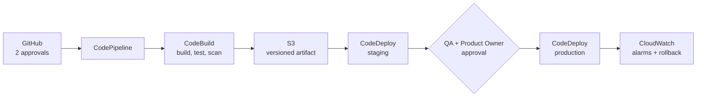
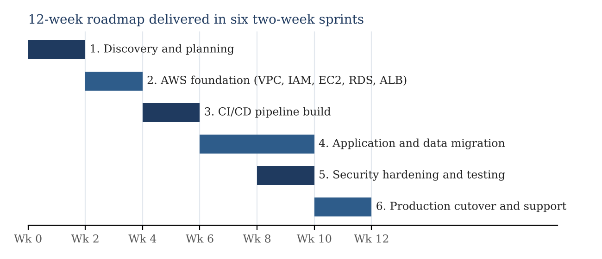
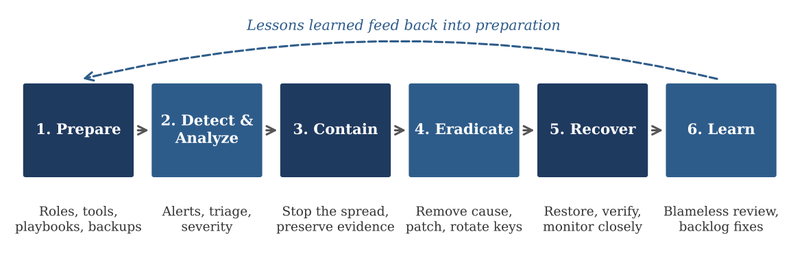

# AWS Cloud Migration & DevOps Strategic Plan ☁️🚀
**Academic Project, ECPI University (CYB350)** | DevOps & Project Management | Amazon Web Services

## 📋 Overview
As the project manager for a consulting firm, I built a complete strategic plan to move **ACME Cloud Corp** (a fictional client) from a legacy Java web application, built and deployed by hand on its own servers, to **AWS**, within a **$25,000 annual budget**. The plan has four parts: a Scrum Team Agreement, an asset and CI/CD plan, an impact outline (the business case), and a security assessment with an incident response plan.

| Key figure | Value |
|---|---|
| Delivery timeline | **12 weeks** (six two-week sprints) |
| Annual cloud cost (with security services) | **~$5,604**, about 22% of the $25,000 budget |
| Assets identified, costed, and assigned an owner | **22** |
| CI/CD pipeline stages with quality gates | **12** |
| Threats modeled with mitigations and playbooks | **5** |

📄 **Full plan (34 pages):** [ACME_Cloud_Migration_Strategic_Plan.pdf](docs/ACME_Cloud_Migration_Strategic_Plan.pdf)

## 🛠️ Technologies
`AWS` `Amazon EC2` `Amazon RDS` `AWS IAM` `AWS CodePipeline` `AWS CodeBuild` `AWS CodeDeploy` `Amazon S3` `Application Load Balancer` `AWS WAF` `AWS Shield` `Amazon GuardDuty` `AWS Security Hub` `AWS Config` `Amazon Inspector` `AWS CloudTrail` `Amazon CloudWatch` `AWS Secrets Manager` `AWS KMS` `GitHub` `Jira` `Scrum`

## 🏗️ Target Architecture

---

## Part 1: Scrum Team Agreement 🤝
Set how a seven-person Scrum team works: a **Definition of Ready**, a nine-point **Definition of Done**, the meeting schedule, and performance measures.

- **Definition of Done highlights:** two peer approvals, 80%+ test coverage on new code, a green CodePipeline run, zero critical/high security findings, least-privilege IAM review, tested database rollback, Product Owner sign-off, and cost tagging.
- **Meeting cadence:** 15-minute daily standups, plus sprint planning, refinement, review, and retrospective, each with a set time limit.

| Performance measure | Target |
|---|---|
| Sprint commitment reliability | 85% or higher |
| Pipeline success rate | 90% or higher |
| Escaped defects | 2 or fewer per sprint |
| Blocker resolution time | 24 hours or less |

## Part 2: Asset Identification & CI/CD Plan 💲
Identified **22 assets** (cloud, network, security, tooling, people, and policy), each with a monthly and annual cost and the role responsible for sourcing it. Instance counts: **2 EC2** (production + staging), **1 RDS**, **4 IAM service roles** plus individual MFA accounts, **1 load balancer**, and **1 pipeline**.

**CI/CD pipeline:** every gate matches the Definition of Done, and the only manual step is the Product Owner's release approval.

## Part 3: Impact Outline (Business Case) 📈
Wrote for a CEO audience: the project phases, deliverables, and five benefits, backed by industry research (IDC; DORA *Accelerate State of DevOps*).

| Benefit | Supporting data |
|---|---|
| Lower, predictable costs | IDC: 51% lower cost of operations after moving to AWS |
| Faster, safer releases | DORA: elite teams deploy 208× more often, with a 7× lower change failure rate |
| Higher availability | IDC: 94% less productive time lost to unplanned outages |
| Stronger security | Shared responsibility model, MFA, least privilege, encryption, scanning on every change |
| Room to grow | IDC: 82% faster deployment of new compute resources |

## Part 4: Security Assessment & Incident Response 🔐
| # | Threat | Avenue of attack | Key mitigations |
|---|---|---|---|
| T1 | Compromised credentials | Phishing, leaked access keys, overly broad IAM | MFA, IAM roles instead of long-lived keys, Secrets Manager rotation, GuardDuty |
| T2 | Injection / web app attacks | SQL injection, XSS, outdated Java libraries | Parameterized queries, AWS WAF managed rules, static and dependency scanning |
| T3 | CI/CD supply-chain compromise | Malicious dependency, stolen GitHub token, tampered artifact | Branch protection, pinned dependencies, least-privilege pipeline roles, approval gate |
| T4 | Cloud misconfiguration | Public RDS or S3, open SSH, unencrypted snapshots | Private subnets, Session Manager, S3 Block Public Access, AWS Config + Security Hub |
| T5 | Denial of service | HTTP floods, bot traffic on the login page | Shield Standard, WAF rate-based rules, CloudWatch alarms, Auto Scaling |

**Security policies:** access control, code reviews, architecture reviews (AWS Well-Architected security pillar), a testing schedule (every commit through yearly penetration tests), patching deadlines (critical within 7 days), data protection, logging, and backups.

**Incident response plan** (based on NIST SP 800-61 Rev. 3 and the AWS Security Incident Response Guide): response team roles, four severity levels with response times, six phases, a checklist for returning to normal operations, and a first-response playbook for each threat.

---

## 💡 Skills Demonstrated
Cloud migration planning · AWS architecture (EC2, RDS, IAM) · CI/CD with AWS CodePipeline · Scrum & Agile project management · Cost estimation & budgeting · Threat modeling · Security policy writing · Incident response planning · Stakeholder communication · Technical writing
